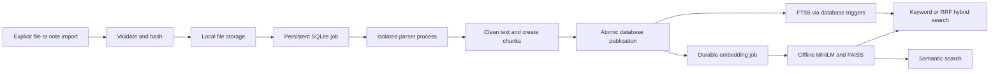

# ECHO

**Local-first document memory and retrieval research.**

ECHO is a software-only research project exploring how people can find documents
by describing what they remember. It operates on content the user explicitly
imports, with local storage and a local API.

The current release implements secure ingestion, keyword/semantic/hybrid
retrieval, contextual reranking and evaluation with tuning-only weight sweeps.
ECHO cannot recover information that was never captured.

[Quick start](#quick-start) · [API](#api) · [Configuration](#configuration) ·
[Research](#research) · [Roadmap](#roadmap) · [Documentation](#documentation)

## Project status

**Version 0.5.0 · Search, evaluation and contextual reranking · Research data awaited**

| Available now | Planned |
| --- | --- |
| Validated document imports and recoverable indexing | Local React dashboard |
| Keyword, semantic, hybrid and contextual hybrid search | Final dashboard/API hardening |
| Filters, source management, previews and cross-store deletion | Research findings from user-supplied data |
| Four-method evaluation and tuning-only weight sweeps | Optional OCR and webpage capture, only on request |
| Authenticated loopback API and structured logs | |

Extraction makes content available to keyword search and queues a separate
embedding job. A source is fully indexed when `processing_status` is `indexed`.
No retrieval accuracy or performance results have been reported.

## Capabilities

- **Explicit capture.** Import selected files or write a note; ECHO does not scan
  folders, monitor browsing or retrieve external content.
- **Validated inputs.** Inspect file contents, enforce size limits, reject unsafe
  DOCX archives and keep user-supplied filenames out of storage paths.
- **Document preparation.** Extract and normalize text while preserving PDF page
  numbers, supported headings and exact chunk offsets.
- **Recoverable processing.** Persist jobs in SQLite, isolate parsers in child
  processes and publish documents and chunks atomically.
- **Four retrieval modes.** Search with FTS5 BM25, local MiniLM embeddings,
  Reciprocal Rank Fusion or hybrid with normalized contextual reranking.
  Results group chunks by source with referenced excerpts.
- **Controlled scope.** Filter by source type, capture date and collection;
  rename, preview or delete imported sources through the local API.
- **Reproducible comparisons.** Evaluate all four retrieval methods on an
  isolated corpus, with separate tuning/test queries and recorded provenance.
  Sweep explicit reranker weights on tuning queries only; defaults are untuned.
- **Local operation.** Store application data locally and require a session token
  on every API request. The current runtime makes no outbound network or AI API
  calls and includes no telemetry integration.

### Supported inputs

| Format | Support | Notes |
| --- | --- | --- |
| PDF | Embedded text, page metadata | Password-protected and image-only PDFs are unsupported; OCR is not enabled |
| TXT | UTF-8, optional UTF-8 BOM, BOM-marked UTF-16 | Legacy encodings and UTF-32 are rejected |
| Markdown | Text and ATX heading metadata | Source markup is retained; headings inside fenced code are excluded |
| DOCX | Body paragraphs, headings and tables, including nested tables | Ancillary content and complex layouts are not comprehensively extracted |
| Manual note | Title and text supplied as JSON | Title up to 200 characters; text up to 100,000 characters |

See the [ingestion specification](docs/ingestion.md) for extraction limits,
normalization rules and recovery behavior.

## Architecture

The implemented pipeline is:



The backend uses **Python, FastAPI, Pydantic v2, SQLAlchemy 2.x, Alembic and
SQLite**. PyMuPDF and python-docx provide document extraction; sentence-transformers
and FAISS provide local semantic retrieval. One coordinator processes ingestion
and indexing jobs serially. The CPU embedding model is loaded once, on demand.
The React dashboard belongs to M6.

## Quick start

### Requirements

- Python **3.11+** with SQLite FTS5 support.
- Windows is the primary development target; commands below use PowerShell.
- Git to clone the repository; network access for dependency installation and
  the explicit one-time model download. Application runtime stays offline.

The verified environment is **Windows, Python 3.12.6 and SQLite 3.45.3**.
Python 3.11 and other operating systems have not yet been verified.

### 1. Install

```powershell
git clone https://github.com/Sachin844123/Echo.git
Set-Location Echo
py -3.12 -m venv .venv
.\.venv\Scripts\python.exe -m pip install -r backend\requirements-dev.txt -c backend\requirements-lock.txt
```

The dependency lock records the resolved environment, including transitive
versions; it is not a hash-verified supply-chain lock. Virtual-environment
activation is optional.

Download the official embedding model once, from the repository root:

```powershell
.\.venv\Scripts\python.exe scripts\prepare_model.py --revision 1110a243fdf4706b3f48f1d95db1a4f5529b4d41
```

The script saves only required model files under `.local/models/`, records the
revision and SHA-256 checksums, and refuses to overwrite an existing directory.
This is a setup utility with network access; the API never calls it. For an
offline machine, copy the complete prepared model directory from another machine.
Without the model, imports and keyword search work; semantic indexing/search
report a visible model error. See [model setup and recovery](docs/search.md).

### 2. Initialize and start

From the repository root:

```powershell
Set-Location backend
..\.venv\Scripts\python.exe -m app migrate
$env:ECHO_SESSION_TOKEN = (& ..\.venv\Scripts\python.exe -m app token).Trim()
..\.venv\Scripts\python.exe -m app serve
```

The API listens on **`http://127.0.0.1:8000`**. Stop it with **Ctrl+C**.
Migrations are explicit and idempotent; startup rejects missing or outdated
schemas. Stop the server and back up the data directory before future upgrades.

The token is captured in the shell environment without being printed or saved
to a file. Generate a fresh token for each session. Restart with a new token to
rotate it, then clear the shell copy after stopping:

```powershell
Remove-Item Env:ECHO_SESSION_TOKEN
```

## API

Every API request requires:

```http
Authorization: Bearer <session-token>
```

Use a client terminal with the same `ECHO_SESSION_TOKEN` value as the server.
Supply that value privately; never put it in a URL or a committed file.

| Method | Endpoint | Purpose |
| --- | --- | --- |
| `GET` | `/api/v1/health` | Check application and database availability |
| `POST` | `/api/v1/imports/files?filename=<name>` | Import a file as the raw request body |
| `POST` | `/api/v1/imports/notes` | Import a JSON note containing `title` and `text` |
| `GET` | `/api/v1/indexing-jobs?limit=20&offset=0` | List jobs and coordinator liveness |
| `GET` | `/api/v1/indexing-jobs/{id}` | Read status, attempts, errors and chunk count |
| `POST` | `/api/v1/indexing-jobs/{id}/retry` | Retry an eligible failed job |
| `POST` | `/api/v1/search` | Keyword, semantic, hybrid or contextual hybrid search |
| `GET` | `/api/v1/index/status` | Model availability, indexing completeness and pending deletions |
| `GET` | `/api/v1/sources` | Paginated source library |
| `GET`, `PATCH`, `DELETE` | `/api/v1/sources/{id}` | Read metadata, rename or delete a source |
| `GET` | `/api/v1/sources/{id}/document` | Bounded document-text preview |
| `GET` | `/api/v1/sources/{id}/chunks` | Paginated chunks and their references |
| `GET`, `POST` | `/api/v1/collections` | List or create collections |
| `DELETE` | `/api/v1/collections/{id}` | Delete a collection, retaining its sources |
| `PUT`, `DELETE` | `/api/v1/collections/{id}/sources/{source_id}` | Add or remove membership |

### Check health

```powershell
$headers = @{ Authorization = "Bearer $env:ECHO_SESSION_TOKEN" }
Invoke-RestMethod -Uri 'http://127.0.0.1:8000/api/v1/health' -Headers $headers
```

A healthy response is:

```json
{"status":"ok","version":"0.5.0","database":"ok"}
```

Opening the endpoint in a browser address bar without the token returns `401`.
Swagger, ReDoc and public OpenAPI endpoints are disabled.

### Import a document

Replace the example path with a document you own:

```powershell
$file = Get-Item -LiteralPath 'C:\path\paper.pdf'
$name = [uri]::EscapeDataString($file.Name)
$job = Invoke-RestMethod -Method Post `
  -Uri "http://127.0.0.1:8000/api/v1/imports/files?filename=$name" `
  -Headers $headers -ContentType 'application/octet-stream' -InFile $file.FullName

Invoke-RestMethod `
  -Uri "http://127.0.0.1:8000/api/v1/indexing-jobs/$($job.job_id)" `
  -Headers $headers
```

File uploads use a **raw body**, not multipart form data. A new import returns
`202` with source/job IDs. Identical captured bytes return `200` with the existing
IDs; the first capture's metadata is retained.

Poll the returned ingestion job until `succeeded` or `failed`. Success creates
a second job with `stage: indexing`; inspect the source or job list for embedding
completion. Failed jobs expose fixed error codes, safe messages and retry
eligibility. Indexing failure retains extracted content and keyword search.

### Search imported content

```powershell
$body = @{ query = 'the paper about storing solar energy'; mode = 'hybrid'; limit = 10 } | ConvertTo-Json
Invoke-RestMethod -Method Post -Uri 'http://127.0.0.1:8000/api/v1/search' `
  -Headers $headers -ContentType 'application/json' -Body $body
```

Use `keyword`, `semantic`, `hybrid` or `hybrid_contextual`. Optional filters are `source_types`,
`captured_from`, `captured_to` and `collection_id`; dates require an explicit
timezone. Responses include one best excerpt per source, page/heading/offset
references and an `indexing_incomplete` flag. Dates filter results without a
recency boost. [Search contracts and examples](docs/search.md) cover score
semantics, grouping and recovery. For method D, optional `context.source_types`
and `context.collection_id` are soft ranking hints, separate from hard filters.
The [reranking guide](docs/reranking.md) defines signals, scores and tuning.

### Inspect chunks locally

From the repository root:

```powershell
.\.venv\Scripts\python.exe scripts\inspect_chunks.py --source-id 1 --limit 20
```

Replace `1` with the returned source ID. Metadata is displayed by default.
Add `--show-text` only when deliberately displaying private document text in
your terminal; do not redirect that output into operational logs.

## Configuration

Configuration is read from environment variables and validated at startup.
`.env` files are not loaded automatically. Local application data defaults to
`.local/` under the repository and is excluded from Git.

| Variable | Default | Purpose |
| --- | --- | --- |
| `ECHO_DATA_DIR` | Repository `.local/` | Database and imported-file storage |
| `ECHO_HOST` | `127.0.0.1` | Only this bind address is accepted |
| `ECHO_PORT` | `8000` | Local port, from 1024 to 65535 |
| `ECHO_SESSION_TOKEN` | Required to serve | Generated bearer token |
| `ECHO_ALLOWED_ORIGINS` | `["http://127.0.0.1:<port>"]` | JSON array of exact loopback HTTP origins |
| `ECHO_LOG_LEVEL` | `INFO` | `INFO`, `WARNING` or `ERROR` |
| `ECHO_MAX_UPLOAD_BYTES` | `20971520` (20 MiB) | Per-file byte ceiling |
| `ECHO_MAX_EXTRACTED_CHARS` | `5000000` | Cleaned-document character ceiling |
| `ECHO_MAX_PDF_PAGES` | `2000` | PDF page ceiling |
| `ECHO_MAX_DOCX_EXPANDED_BYTES` | `67108864` (64 MiB) | Expanded DOCX archive ceiling |
| `ECHO_EXTRACTION_TIMEOUT_SECONDS` | `120` | Parser-process timeout |
| `ECHO_CHUNK_TOKENS` | `350` | Lexical-token window |
| `ECHO_CHUNK_OVERLAP` | `60` | Overlap; must be below the window size |
| `ECHO_MAX_JOB_ATTEMPTS` | `3` | Total attempts, including interruptions |
| `ECHO_MAX_PENDING_JOBS` | `100` | Combined pending/running capacity |
| `ECHO_EMBEDDING_MODEL_NAME` | `sentence-transformers/all-MiniLM-L6-v2` | Expected model identity |
| `ECHO_EMBEDDING_MODEL_DIR` | Repository `.local/models/all-MiniLM-L6-v2/` | Prepared offline model |
| `ECHO_EMBEDDING_BATCH_SIZE` | `16` | Maximum model windows per inference batch |
| `ECHO_EMBEDDING_THREADS` | `2` | CPU Torch threads |
| `ECHO_CANDIDATE_POOL` | `50` | Filtered candidates per retrieval method |
| `ECHO_RESULT_LIMIT` | `10` | Visible source results; cannot exceed candidate pool |
| `ECHO_RRF_K` | `60` | Reciprocal Rank Fusion constant |
| `ECHO_RERANK_WEIGHTS` | See reranking guide | JSON weights for normalized RRF, title/heading, keyword, source-type and collection signals |

Chunk sizes are deterministic lexical approximations, not embedding-model token
counts. MiniLM input is split into model-sized WordPiece windows and pooled,
so long chunks are not silently truncated. These are engineering defaults to
benchmark and tune, not demonstrated quality or performance guarantees.

## Security and privacy

- **Loopback only:** the supported launcher binds to `127.0.0.1`, disables proxy
  trust and validates the client address and Host header.
- **Authenticated requests:** every API call requires the session token. Browser
  origins must match the explicit allowlist; native clients may omit Origin.
- **Restrictive CORS:** GET/POST/PATCH/PUT/DELETE and Authorization/Content-Type are allowed.
  Validated browser preflight exposes transport policy without invoking a route;
  subsequent API requests still require authentication.
- **Content-safe logs:** fixed events and operational metadata exclude tokens,
  bodies, queries, file paths, SQL parameters and raw exception messages.
- **Local storage:** no cloud sync, accounts, external AI calls or runtime
  telemetry integration is present.

ECHO does **not** provide encryption at rest or end-to-end encryption. Parser
subprocesses isolate failures but are not an OS sandbox or a hard memory quota.
Same-user malicious code and administrators remain outside the local HTTP trust
boundary. Deletion removes database rows, FTS entries, vectors and owned files;
interrupted removal is retried. This does not promise forensic erasure of WAL,
backups or SSD blocks. Broader application hardening remains M6.

Read the [security model](docs/security-model.md) before deploying or extending
this boundary. The service is intended for local use, not exposure through a
public proxy or tunnel.

## Testing

From the repository root:

```powershell
.\.venv\Scripts\python.exe -m pytest -q
.\.venv\Scripts\python.exe -m pip check
```

Coverage includes authentication, migrations, input validation, real parsers,
chunk offsets, concurrent duplicates, retries, FTS synchronization, FAISS
snapshots, RRF, filters, deletion recovery and real offline-model integration.
The recorded M1–M5 regression completed with **257 passing tests**, no skips
and no warnings, on Windows/Python 3.12.6.

Tests use temporary databases and explicitly synthetic fixtures. They require
local loopback sockets. Provision the model above to run the real-model tests;
real-model tests explicitly skip when its descriptor is absent. Tests never
download a model or call an external service. Test-suite
duration is not a retrieval benchmark. See the [verification record](docs/PROGRESS.md)
for executed commands, results and known limitations.

## Research

The central research question is:

> Does hybrid keyword and semantic retrieval, with and without contextual
> reranking, recover remembered content more effectively than either method alone
> on a labelled dataset?

The harness compares keyword, semantic, Reciprocal Rank Fusion and contextual hybrid retrieval
on one fully indexed corpus. It measures **Precision@5, Recall@5, MRR (cutoff 10)
and NDCG@10**, warm in-process latency median/p95, indexing wall time and sampled
process memory. Method D uses the same hybrid candidates plus normalized title/
heading, exact keyword overlap and explicit source-type/collection context.

Real documents and relevance labels will be supplied for the research dataset.
Tuning and final-test queries will remain separate; reranker weights must never
be tuned on the final reporting split. No research corpus, relevance labels or
benchmark results are bundled or fabricated.

Once your labelled dataset is ready, run from the repository root:

```powershell
.\.venv\Scripts\python.exe evaluation\run_eval.py `
  --dataset .local\datasets\my-study\dataset.json `
  --config evaluation\config.example.json --split tuning `
  --output .local\evaluation\my-study-tuning-01
```

The output directory must be new. Runs use private corpus copies and never
overwrite your application library. Final test-split evaluation requires an
explicit frozen configuration. JSON/CSV reports contain metrics, measurements,
opaque IDs and fingerprints, without query text or document content. Add
`--weight-sweep evaluation\weights.example.json` only to a tuning run to report
every weight setting and save configurations for a later fixed test run. The
[evaluation guide](evaluation/README.md) defines dataset format, grading, split
discipline and measurement limitations. No real study has been run yet.

## Roadmap

| Milestone | Deliverable | Status |
| --- | --- | --- |
| M1 · Foundation | Configuration, schema, migrations, local API security and initial tests | Complete |
| M2 · Ingestion | Validated imports, extraction, chunking and recoverable jobs | Complete |
| M3 · Search engine | FTS5, FAISS, keyword/semantic/hybrid retrieval, filters, deletion and reconciliation | Complete |
| M4 · Evaluation | Labelled-dataset harness, metrics, resource measurements and tuning/test split | Complete; study awaits user data |
| M5 · Contextual reranking | Configurable normalized signals and tuning-only weight sweeps | Complete |
| M6 · Dashboard and hardening | Local React dashboard and completed application security flows | Planned |
| M7 · Optional extensions | OCR, webpage capture and packaging notes | Only on request |

Development proceeds one milestone at a time. Desktop packaging, browser
extensions, mobile applications, cloud sync, accounts, PostgreSQL, local LLMs,
orchestration frameworks and separate vector database servers are outside the
research-core implementation.

## Repository structure

```text
backend/
  app/
    api/                  Local HTTP endpoints
    core/                 Configuration and logging
    database/             Models and database lifecycle
    ingestion/            Durable job coordination
    extraction/           Isolated document parsers
    processing/           Cleaning and chunking
    security/             Request and file validation
    storage/              App-owned files and instance locking
    embeddings/           Offline model verification and bounded inference
    retrieval/            FAISS snapshots, search, RRF and reconciliation
  migrations/             Alembic schema revisions
  tests/                  Foundation, ingestion, retrieval and evaluation tests
scripts/
  inspect_chunks.py       Local chunk inspection
  prepare_model.py        Explicit setup-only model download
evaluation/
  datasets/               Git-ignored user-supplied research data
  dataset.py              Strict manifests, splits and configuration
  metrics.py              Source-level ranking metrics
  resources.py            Native process memory sampling
  run_eval.py             Isolated four-method comparison and tuning sweeps
  sweep.py                Explicit validated weight-setting grids
  config.example.json     Explicit benchmark defaults
  weights.example.json    Untuned example settings and RRF-only ablation
  README.md               Dataset and measurement protocol
docs/                     Design, security and implementation records
```

The frontend will be introduced in M6.

## Documentation

| Document | Contents |
| --- | --- |
| [Progress and verification](docs/PROGRESS.md) | Implemented scope, file inventory, executed checks and limitations |
| [Engineering decisions](docs/decisions.md) | Architectural choices and dependency rationale |
| [Database schema](docs/schema.md) | Tables, relationships, constraints and lifecycle semantics |
| [Ingestion specification](docs/ingestion.md) | Import contract, supported formats, processing and recovery |
| [Search specification](docs/search.md) | Retrieval, model setup, filters, source APIs and recovery |
| [Contextual reranking](docs/reranking.md) | Normalized signals, soft hints, method D and tuning-only sweeps |
| [Security model](docs/security-model.md) | Implemented protections and trust boundaries |
| [Evaluation guide](evaluation/README.md) | Dataset contract, scoring, measurements and held-out protocol |
| [Changelog](CHANGELOG.md) | Versioned development history |
| [Contributor instructions](AGENTS.md) | Repository workflow and scope constraints |
