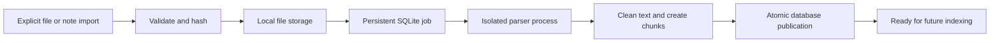

# ECHO

**Local-first document memory and retrieval research.**

ECHO is a software-only research project exploring how people can find documents
by describing what they remember. It operates on content the user explicitly
imports, with local storage and a local API.

The current release implements secure ingestion and document preparation.
Retrieval and comparative evaluation are the next stages of development.
ECHO cannot recover information that was never captured.

[Quick start](#quick-start) · [API](#api) · [Configuration](#configuration) ·
[Research](#research) · [Roadmap](#roadmap) · [Documentation](#documentation)

## Project status

**Version 0.2.0 · Foundation and ingestion complete · Search engine pending**

| Available now | Planned |
| --- | --- |
| PDF, TXT, Markdown, DOCX and manual-note imports | Keyword, semantic and hybrid search |
| Content validation and SHA-256 duplicate detection | SQLite FTS5 indexing and FAISS vectors |
| Text extraction, cleaning and contextual metadata | Source filters, management and consistent deletion |
| Overlapping chunks with exact text offsets | Labelled-dataset evaluation and contextual reranking |
| Persistent jobs, retries and interrupted-job recovery | Local React dashboard |
| Authenticated loopback API and structured logs | Full application hardening |

A successful import means the document is **ready for indexing**. It does not
mean the document is searchable. No retrieval accuracy or performance results
have been reported.

## Capabilities

- **Explicit capture.** Import selected files or write a note; ECHO does not scan
  folders, monitor browsing or retrieve external content.
- **Validated inputs.** Inspect file contents, enforce size limits, reject unsafe
  DOCX archives and keep user-supplied filenames out of storage paths.
- **Document preparation.** Extract and normalize text while preserving PDF page
  numbers, supported headings and exact chunk offsets.
- **Recoverable processing.** Persist jobs in SQLite, isolate parsers in child
  processes and publish documents and chunks atomically.
- **Local operation.** Store application data locally and require a session token
  on every API request. The current runtime makes no outbound network or AI API
  calls and includes no telemetry integration.

### Supported inputs

| Format | Support | Notes |
| --- | --- | --- |
| PDF | Embedded text, page metadata | Password-protected and image-only PDFs are unsupported; OCR is not enabled |
| TXT | UTF-8, optional UTF-8 BOM, BOM-marked UTF-16 | Legacy encodings and UTF-32 are rejected |
| Markdown | Text and ATX heading metadata | Source markup is retained; headings inside fenced code are excluded |
| DOCX | Body paragraphs, headings and tables, including nested tables | Ancillary content and complex layouts are not comprehensively extracted |
| Manual note | Title and text supplied as JSON | Title up to 200 characters; text up to 100,000 characters |

See the [ingestion specification](docs/ingestion.md) for extraction limits,
normalization rules and recovery behavior.

## Architecture

The implemented ingestion pipeline is:



The backend uses **Python, FastAPI, Pydantic v2, SQLAlchemy 2.x, Alembic and
SQLite**. PyMuPDF and python-docx provide document extraction. One coordinator
processes ingestion jobs serially, starting one parser child at a time.

FAISS, sentence-transformers and the React dashboard belong to later milestones
and are not part of the current implementation.

## Quick start

### Requirements

- Python **3.11+** with SQLite FTS5 support.
- Windows is the primary development target; commands below use PowerShell.
- Git to clone the repository and network access to install dependencies.

The verified environment is **Windows, Python 3.12.6 and SQLite 3.45.3**.
Python 3.11 and other operating systems have not yet been verified.

### 1. Install

```powershell
git clone https://github.com/Sachin844123/Echo.git
Set-Location Echo
py -3.12 -m venv .venv
.\.venv\Scripts\python.exe -m pip install -r backend\requirements-dev.txt -c backend\requirements-lock.txt
```

The dependency lock records the resolved environment, including transitive
versions; it is not a hash-verified supply-chain lock. Virtual-environment
activation is optional. No embedding model is downloaded in the current release.

### 2. Initialize and start

From the repository root:

```powershell
Set-Location backend
..\.venv\Scripts\python.exe -m app migrate
$env:ECHO_SESSION_TOKEN = (& ..\.venv\Scripts\python.exe -m app token).Trim()
..\.venv\Scripts\python.exe -m app serve
```

The API listens on **`http://127.0.0.1:8000`**. Stop it with **Ctrl+C**.
Migrations are explicit and idempotent; startup rejects missing or outdated
schemas. Stop the server and back up the data directory before future upgrades.

The token is captured in the shell environment without being printed or saved
to a file. Generate a fresh token for each session. Restart with a new token to
rotate it, then clear the shell copy after stopping:

```powershell
Remove-Item Env:ECHO_SESSION_TOKEN
```

## API

Every API request requires:

```http
Authorization: Bearer <session-token>
```

Use a client terminal with the same `ECHO_SESSION_TOKEN` value as the server.
Supply that value privately; never put it in a URL or a committed file.

| Method | Endpoint | Purpose |
| --- | --- | --- |
| `GET` | `/api/v1/health` | Check application and database availability |
| `POST` | `/api/v1/imports/files?filename=<name>` | Import a file as the raw request body |
| `POST` | `/api/v1/imports/notes` | Import a JSON note containing `title` and `text` |
| `GET` | `/api/v1/indexing-jobs?limit=20&offset=0` | List jobs and coordinator liveness |
| `GET` | `/api/v1/indexing-jobs/{id}` | Read status, attempts, errors and chunk count |
| `POST` | `/api/v1/indexing-jobs/{id}/retry` | Retry an eligible failed job |

### Check health

```powershell
$headers = @{ Authorization = "Bearer $env:ECHO_SESSION_TOKEN" }
Invoke-RestMethod -Uri 'http://127.0.0.1:8000/api/v1/health' -Headers $headers
```

A healthy response is:

```json
{"status":"ok","version":"0.2.0","database":"ok"}
```

Opening the endpoint in a browser address bar without the token returns `401`.
Swagger, ReDoc and public OpenAPI endpoints are disabled.

### Import a document

Replace the example path with a document you own:

```powershell
$file = Get-Item -LiteralPath 'C:\path\paper.pdf'
$name = [uri]::EscapeDataString($file.Name)
$job = Invoke-RestMethod -Method Post `
  -Uri "http://127.0.0.1:8000/api/v1/imports/files?filename=$name" `
  -Headers $headers -ContentType 'application/octet-stream' -InFile $file.FullName

Invoke-RestMethod `
  -Uri "http://127.0.0.1:8000/api/v1/indexing-jobs/$($job.job_id)" `
  -Headers $headers
```

File uploads use a **raw body**, not multipart form data. A new import returns
`202` with source/job IDs. Identical captured bytes return `200` with the existing
IDs; the first capture's metadata is retained.

Poll the job until `succeeded` or `failed`. A successful job reports
`ready_for_indexing`; a failed job exposes a fixed error code, a safe message
and whether retry is permitted. Attempt and queue limits apply to retries.

### Inspect chunks locally

From the repository root:

```powershell
.\.venv\Scripts\python.exe scripts\inspect_chunks.py --source-id 1 --limit 20
```

Replace `1` with the returned source ID. Metadata is displayed by default.
Add `--show-text` only when deliberately displaying private document text in
your terminal; do not redirect that output into operational logs.

## Configuration

Configuration is read from environment variables and validated at startup.
`.env` files are not loaded automatically. Local application data defaults to
`.local/` under the repository and is excluded from Git.

| Variable | Default | Purpose |
| --- | --- | --- |
| `ECHO_DATA_DIR` | Repository `.local/` | Database and imported-file storage |
| `ECHO_HOST` | `127.0.0.1` | Only this bind address is accepted |
| `ECHO_PORT` | `8000` | Local port, from 1024 to 65535 |
| `ECHO_SESSION_TOKEN` | Required to serve | Generated bearer token |
| `ECHO_ALLOWED_ORIGINS` | `["http://127.0.0.1:<port>"]` | JSON array of exact loopback HTTP origins |
| `ECHO_LOG_LEVEL` | `INFO` | `INFO`, `WARNING` or `ERROR` |
| `ECHO_MAX_UPLOAD_BYTES` | `20971520` (20 MiB) | Per-file byte ceiling |
| `ECHO_MAX_EXTRACTED_CHARS` | `5000000` | Cleaned-document character ceiling |
| `ECHO_MAX_PDF_PAGES` | `2000` | PDF page ceiling |
| `ECHO_MAX_DOCX_EXPANDED_BYTES` | `67108864` (64 MiB) | Expanded DOCX archive ceiling |
| `ECHO_EXTRACTION_TIMEOUT_SECONDS` | `120` | Parser-process timeout |
| `ECHO_CHUNK_TOKENS` | `350` | Lexical-token window |
| `ECHO_CHUNK_OVERLAP` | `60` | Overlap; must be below the window size |
| `ECHO_MAX_JOB_ATTEMPTS` | `3` | Total attempts, including interruptions |
| `ECHO_MAX_PENDING_JOBS` | `100` | Combined pending/running capacity |

Chunk sizes are deterministic lexical approximations, not embedding-model token
counts. These are engineering defaults to benchmark and tune, not demonstrated
quality or performance guarantees.

## Security and privacy

- **Loopback only:** the supported launcher binds to `127.0.0.1`, disables proxy
  trust and validates the client address and Host header.
- **Authenticated requests:** every API call requires the session token. Browser
  origins must match the explicit allowlist; native clients may omit Origin.
- **Restrictive CORS:** only GET/POST and Authorization/Content-Type are allowed.
  Validated browser preflight exposes transport policy without invoking a route;
  subsequent API requests still require authentication.
- **Content-safe logs:** fixed events and operational metadata exclude tokens,
  bodies, queries, file paths, SQL parameters and raw exception messages.
- **Local storage:** no cloud sync, accounts, external AI calls or runtime
  telemetry integration is present.

ECHO does **not** provide encryption at rest or end-to-end encryption. Parser
subprocesses isolate failures but are not an OS sandbox or a hard memory quota.
Same-user malicious code and administrators remain outside the local HTTP trust
boundary. Cross-store deletion and broader application hardening are planned.

Read the [security model](docs/security-model.md) before deploying or extending
this boundary. The service is intended for local use, not exposure through a
public proxy or tunnel.

## Testing

From the repository root:

```powershell
.\.venv\Scripts\python.exe -m pytest -q
.\.venv\Scripts\python.exe -m pip check
```

The latest recorded M2 regression completed with **162 passing tests** on
Windows/Python 3.12.6. Coverage includes authentication, migrations, input
validation, real parsers, exact chunk offsets, concurrent duplicates, retries,
timeouts, recovery and a real local HTTP-server import.

Tests use temporary databases and explicitly synthetic fixtures. They require
local loopback sockets, but no external service or embedding model. Test-suite
duration is not a retrieval benchmark. See the [verification record](docs/PROGRESS.md)
for executed commands, results and known limitations.

## Research

The central research question is:

> Does hybrid keyword and semantic retrieval, with and without contextual
> reranking, recover remembered content more effectively than either method alone
> on a labelled dataset?

The planned comparison includes keyword retrieval, semantic retrieval, hybrid
retrieval using Reciprocal Rank Fusion, and hybrid retrieval with contextual
reranking. Evaluation will measure **Precision@5, Recall@5, MRR and NDCG@10**,
along with median/p95 latency, indexing time and memory use.

Real documents and relevance labels will be supplied for the research dataset.
Tuning and final-test queries will remain separate; reranker weights must never
be tuned on the final reporting split. No research corpus, relevance labels or
benchmark results are bundled or fabricated.

The [evaluation notes](evaluation/README.md) describe the current scope.
Evaluation code and the dataset contract arrive in M4.

## Roadmap

| Milestone | Deliverable | Status |
| --- | --- | --- |
| M1 · Foundation | Configuration, schema, migrations, local API security and initial tests | Complete |
| M2 · Ingestion | Validated imports, extraction, chunking and recoverable jobs | Complete |
| M3 · Search engine | FTS5, FAISS, keyword/semantic/hybrid retrieval, filters, deletion and reconciliation | Next |
| M4 · Evaluation | Labelled-dataset harness, metrics, resource measurements and tuning/test split | Planned |
| M5 · Contextual reranking | Configurable normalized signals and tuning-only weight sweeps | Planned |
| M6 · Dashboard and hardening | Local React dashboard and completed application security flows | Planned |
| M7 · Optional extensions | OCR, webpage capture and packaging notes | Only on request |

Development proceeds one milestone at a time. Desktop packaging, browser
extensions, mobile applications, cloud sync, accounts, PostgreSQL, local LLMs,
orchestration frameworks and separate vector database servers are outside the
research-core implementation.

## Repository structure

```text
backend/
  app/
    api/                  Local HTTP endpoints
    core/                 Configuration and logging
    database/             Models and database lifecycle
    ingestion/            Durable job coordination
    extraction/           Isolated document parsers
    processing/           Cleaning and chunking
    security/             Request and file validation
    storage/              App-owned files and instance locking
    embeddings/           Reserved for M3
    retrieval/            Reserved for M3
  migrations/             Alembic schema revisions
  tests/                  Foundation and ingestion tests
scripts/
  inspect_chunks.py       Local chunk inspection
evaluation/
  datasets/               Reserved for user-supplied research data
  README.md               Evaluation scope
docs/                     Design, security and implementation records
```

The frontend will be introduced in M6.

## Documentation

| Document | Contents |
| --- | --- |
| [Progress and verification](docs/PROGRESS.md) | Implemented scope, file inventory, executed checks and limitations |
| [Engineering decisions](docs/decisions.md) | Architectural choices and dependency rationale |
| [Database schema](docs/schema.md) | Tables, relationships, constraints and lifecycle semantics |
| [Ingestion specification](docs/ingestion.md) | Import contract, supported formats, processing and recovery |
| [Security model](docs/security-model.md) | Implemented protections and trust boundaries |
| [Evaluation scope](evaluation/README.md) | Research methods and dataset requirements |
| [Changelog](CHANGELOG.md) | Versioned development history |
| [Contributor instructions](AGENTS.md) | Repository workflow and scope constraints |
