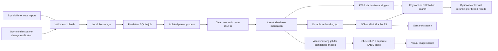

# ECHO

> **Local-first document memory and retrieval research.**

ECHO is a software-only research project exploring how people can find documents
by describing what they remember. It searches manually imported content and
eligible files in folders the user approves. Storage and processing stay local. No cloud sync,
no external AI calls, no telemetry.

ECHO ships a local React dashboard, four text retrieval modes, visual image
search, OCR and a reproducible evaluation harness with tuning-only weight sweeps.

**On Windows:** double-click [`setup.bat`](setup.bat) for first-time setup and
then use [`Run-ECHO.bat`](Run-ECHO.bat) to reopen ECHO. The workspace opens in
your browser without sign-in. See [Quick start](#quick-start) for macOS and Linux.

**ECHO cannot recover information that was never captured.**

---

[Quick start](#quick-start) · [API reference](#api) · [Configuration](#configuration) · [Research](#research) · [Security](#security-and-privacy) · [Roadmap](#roadmap) · [Documentation](#documentation)

---

## Project status

**Application version 0.6.0 · M1–M7 complete for the authorized scope**

| Available now | Planned / Optional |
|---|---|
| Local React dashboard — Search, Library, Collections, Activity, Storage, Settings | Research findings from user-supplied labelled data |
| Validated imports, previews and recoverable indexing pipeline | React Bits dashboard update |
| Keyword, semantic, hybrid and contextual-hybrid retrieval | Webpage capture and packaging require separate authorization |
| OCR for scanned PDFs and PNG/JPEG, plus visual image search | |
| Opt-in folder monitoring and automatic indexing on Windows | |
| Four-method evaluation harness with tuning-only weight sweeps | |
| Authenticated loopback API, local sessions and recoverable deletion | |

Successful extraction makes content available to keyword search while the
embedding jobs run. A source is fully indexed when its `processing_status`
reaches `indexed`. The research evaluation awaits a user-supplied labelled dataset.

---

## Capabilities

### Capture and ingestion

- **Capture with consent.** Import files, write a note, or grant access to local
  folders in [Storage & Permissions](docs/local-storage.md). New and changed
  files are indexed through the same pipeline. Revoke access to purge automatic
  copies and keep manual imports.
- **Validated inputs.** File contents are inspected, size limits enforced, unsafe
  DOCX archives rejected, and user-supplied filenames kept out of storage paths.
- **Document preparation.** Text is extracted and normalized while preserving PDF
  page numbers, ATX headings and Unicode character offsets.
- **Recoverable processing.** Jobs persist in SQLite. Parsers run in isolated
  child processes; documents and chunks are published atomically on success.
  Interrupted jobs are retried up to the configured attempt ceiling.

### Retrieval

- **Four text retrieval modes.** FTS5 BM25 keyword, local MiniLM embeddings (FAISS),
  Reciprocal Rank Fusion (RRF) hybrid, and normalized contextual hybrid with
  additional title/heading, keyword-overlap and collection signals.
- **Image search.** Use **Images** to search standalone PNG and JPEG imports by
  appearance with local CLIP. Use **Keywords** or **Hybrid** with the **Image**
  filter to search filenames and text recognized by OCR.
- **Result grouping.** Chunks are grouped by source document; each result
  surfaces one excerpt with page, heading and character-offset references.
- **Spelling and candidate coverage.** The dashboard can correct likely typos
  using its local vocabulary. The default `source_balanced` profile groups
  candidates by source before hybrid fusion.
- **Controlled filtering.** Results can be scoped by source type, capture date
  range and collection. Date filters apply without a recency boost.

### Evaluation

- **Reproducible comparisons.** The harness compares all four methods on an
  isolated corpus using separate tuning and test query splits.
- **Metrics:** Precision@5, Recall@5, MRR (cutoff 10) and NDCG@10, plus warm
  in-process latency (median/p95), indexing wall time and sampled process memory.
- **Sweep discipline.** Reranker weights are swept only on tuning queries;
  defaults ship untuned. The final test split is never touched until a frozen
  configuration is explicitly supplied.

### Local operation

- **No outbound calls at runtime.** The API makes no network requests, no
  external AI API calls, and includes no telemetry integration.
- **Direct local dashboard.** Open the workspace without entering a token.
  The browser connects automatically to the loopback-only API.

---

## Supported input formats

| Format | Extraction | Notes |
|---|---|---|
| **PDF** | Embedded text, local OCR, page metadata | OCR requires local language data. Password-protected files are unsupported. |
| **PNG / JPEG** | Filename, local OCR and visual embeddings | See [OCR and image search](docs/images.md) for model setup and limits. |
| **TXT** | UTF-8, optional UTF-8 BOM, BOM-marked UTF-16 | Legacy encodings and UTF-32 are rejected |
| **Markdown** | Text and ATX heading metadata | Source markup retained; headings inside fenced code blocks excluded |
| **DOCX** | Body paragraphs, headings and tables (including nested) | Ancillary content and complex layouts not comprehensively extracted |
| **Manual note** | Title and body text supplied as JSON | Title up to 200 chars; body up to 100,000 chars |

See the [ingestion specification](docs/ingestion.md) for extraction limits,
normalization rules and recovery behavior.

---

## Architecture

### Pipeline overview



### Technology stack

| Layer | Technology |
|---|---|
| **API server** | Python 3.11+, FastAPI, Pydantic v2 |
| **Database** | SQLite with FTS5, SQLAlchemy 2.x, Alembic migrations |
| **Document parsing and OCR** | PyMuPDF with Tesseract language data, python-docx |
| **Semantic retrieval** | sentence-transformers `all-MiniLM-L6-v2`, FAISS (CPU) |
| **Visual retrieval** | CLIP ViT-B/32, Pillow, separate FAISS index (CPU) |
| **Frontend** | React, TypeScript, Vite, Tailwind CSS |
| **Job coordination** | Single serial coordinator; local models load on demand |

The React dashboard is built locally and served by the same FastAPI process.
No separate server or proxy is required in production mode.

---

## Quick start

### Requirements

| Requirement | Version | Notes |
|---|---|---|
| Python | **3.11+** | SQLite FTS5 support required |
| Node.js with npm | **Node 22.12+** | Only needed to build the dashboard |
| Git | Any recent | Optional if you download the ZIP |
| OS | Windows (primary) | Setup scripts for Windows, macOS, and Linux |

> [!NOTE]
> The verified environment is **Windows, Python 3.12.6 and SQLite 3.45.3**.
> Python 3.11 and other operating systems have not yet been verified.

---

### 1. Get ECHO and run setup

Clone the repository or download the GitHub ZIP and extract it to a writable
folder. Install Python 3.11+ (3.12 recommended) and Node.js 22.12+ with npm
first, then use the setup script for your operating system.

| Platform | First-run setup |
| --- | --- |
| Windows | Double-click [`setup.bat`](setup.bat) or run `.\setup.bat` from PowerShell. |
| macOS and Linux | Open a terminal in the extracted repository and run `bash setup.sh`. |

Setup creates `.venv`, installs the pinned Python and npm dependencies,
builds the dashboard, and prepares MiniLM, English OCR, and CLIP by default.
It then initializes or migrates the database and opens ECHO in your browser.
Allow internet access and several GB of free disk space for the first setup.
ECHO runs locally after setup. Reruns reuse and verify prepared model files.
Close the ECHO server before rerunning setup.

Add `--no-launch` to prepare the database and exit. Add `--skip-models`
to skip model downloads if you only need keyword search. Combine the options,
for example `.\setup.bat --no-launch --skip-models` in PowerShell or
`bash setup.sh --no-launch --skip-models` in a shell. If Linux reports that
`ensurepip` is missing, enable venv support for your Python installation
(for example, install `python3-venv` on Debian or Ubuntu) and rerun setup.

**VS Code and Antigravity users:** open the `Echo` repository folder. Workspace
settings point to `.venv\Scripts\python.exe` on Windows. `pyproject.toml`
configures Pylance/Pyright for `app.*` imports. If the editor already selected
a different interpreter, run
**Python: Select Interpreter → `.venv\Scripts\python.exe`**, then
**Developer: Reload Window**. Do not disable import diagnostics or rewrite
backend imports to remove editor underlines. See the
[VS Code interpreter settings](https://code.visualstudio.com/docs/python/settings-reference)
and [Pyright configuration](https://github.com/microsoft/pyright/blob/main/docs/configuration.md).

---

### 2. Reopen the dashboard

Double-click [`Run-ECHO.bat`](Run-ECHO.bat) in File Explorer, or run
`.\Run-ECHO.bat` from the repository root in PowerShell. On the first launch,
the script builds the dashboard if needed, then initializes or migrates the
database and opens [ECHO on loopback](http://127.0.0.1:8000/). The launcher
prints the address if you use a different port.

On macOS or Linux, run the following from the repository root after setup:

```sh
cd backend
../.venv/bin/python -m app launch
```

The workspace opens directly. On the first visit, choose a storage access level
or deny access to use manual imports only. Keep the launcher window open while using ECHO
and press **Ctrl+C** there to stop it. After frontend edits, run
`.\Run-ECHO.bat --build` to rebuild the dashboard. See the
[dashboard guide](frontend/README.md) for a manual build or Vite development setup.

> [!CAUTION]
> Stop any running ECHO server before launching another instance. Back up
> `.local/` with the server stopped before upgrading your library.

### 3. Enable local models as needed

Stop the server, then run the setup commands you need from the repository root.
Each command downloads public assets once. Search and OCR run offline afterward.

```powershell
# Meaning, Hybrid and Hybrid + context
.\.venv\Scripts\python.exe scripts\prepare_model.py --revision 1110a243fdf4706b3f48f1d95db1a4f5529b4d41

# OCR for scanned PDFs and text in images
.\.venv\Scripts\python.exe scripts\prepare_image_models.py ocr

# Search image appearance with the Images mode
.\.venv\Scripts\python.exe scripts\prepare_image_models.py visual
```

The setup scripts store assets under `.local/models/` and preserve existing
model directories. Restart ECHO after setup. **Keywords** can search native text
without MiniLM. Use **Activity** to retry failed indexing jobs after installing
a model, or choose **Reprocess** on an imported scan to apply OCR. See
[model recovery](docs/search.md) and the [OCR and image guide](docs/images.md).

---

## API

The dashboard handles API authentication automatically. To call the API from
PowerShell or another native client, optionally set a separate token in the
server terminal before starting ECHO:

```powershell
# From the repository root, with the launcher stopped
Set-Location backend
$env:ECHO_SESSION_TOKEN = (& ..\.venv\Scripts\python.exe -m app token).Trim()
..\.venv\Scripts\python.exe -m app migrate
if ($LASTEXITCODE -eq 0) { ..\.venv\Scripts\python.exe -m app serve }
```

Native API requests use that token in the Authorization header:

```http
Authorization: Bearer <session-token>
```

> [!WARNING]
> Never put the token in a URL or a committed file. Use a client terminal that
> shares the same `ECHO_SESSION_TOKEN` environment variable as the server.

Swagger, ReDoc and public OpenAPI endpoints are **disabled**. The full API
contract is exercised by the backend test suite.

### Endpoint reference

| Method | Endpoint | Description |
|---|---|---|
| `GET` | `/api/v1/health` | Application and database availability |
| `POST` | `/api/v1/imports/files?filename=<name>` | Import a file (raw request body, not multipart) |
| `POST` | `/api/v1/imports/notes` | Import a JSON note with `title` and `text` fields |
| `GET` | `/api/v1/indexing-jobs?limit=20&offset=0` | List jobs and coordinator liveness |
| `GET` | `/api/v1/indexing-jobs/{id}` | Job status, attempt count, errors and chunk count |
| `POST` | `/api/v1/indexing-jobs/{id}/retry` | Retry an eligible failed job |
| `POST` | `/api/v1/search` | Keyword, semantic, hybrid, contextual-hybrid or visual search |
| `GET` | `/api/v1/index/status` | Model availability, indexing completeness and pending deletions |
| `GET` | `/api/v1/settings` | Read non-sensitive application settings and OCR availability |
| `GET` | `/api/v1/sources` | Paginated source library |
| `GET` / `PATCH` / `DELETE` | `/api/v1/sources/{id}` | Read metadata, rename or soft-delete a source |
| `GET` | `/api/v1/sources/{id}/document` | Bounded document-text preview |
| `GET` | `/api/v1/sources/{id}/image` | Authenticated PNG preview for an imported image |
| `POST` | `/api/v1/sources/{id}/reprocess` | Re-extract and reindex the stored source |
| `GET` | `/api/v1/sources/{id}/chunks` | Paginated chunks with position references |
| `GET` / `POST` | `/api/v1/collections` | List or create collections |
| `DELETE` | `/api/v1/collections/{id}` | Delete a collection (sources are retained) |
| `PUT` / `DELETE` | `/api/v1/collections/{id}/sources/{source_id}` | Add or remove a source from a collection |
| `DELETE` | `/api/v1/library` | Delete library contents with an explicit `DELETE ALL` confirmation |
| `GET` | `/api/v1/storage` | Read local storage consent, folders and indexing progress |
| `GET` | `/api/v1/storage/options` | Read fixed-drive and personal-folder options |
| `GET` | `/api/v1/storage/files` | List tracked files, with pagination |
| `PUT` | `/api/v1/storage/permission` | Set consent, approved folders, exclusions and file type filters |
| `POST` | `/api/v1/storage/control` | Pause, resume, cancel or rescan |

### Examples

#### Check health

```powershell
$headers = @{ Authorization = "Bearer $env:ECHO_SESSION_TOKEN" }
Invoke-RestMethod -Uri 'http://127.0.0.1:8000/api/v1/health' -Headers $headers
```

A healthy response:

```json
{"status": "ok", "version": "0.6.0", "database": "ok"}
```

Raw API requests without a credential return `401`. Swagger and public OpenAPI
routes are disabled.

#### Import a document

```powershell
$file = Get-Item -LiteralPath 'C:\path\paper.pdf'
$name = [uri]::EscapeDataString($file.Name)
$job = Invoke-RestMethod -Method Post `
  -Uri "http://127.0.0.1:8000/api/v1/imports/files?filename=$name" `
  -Headers $headers -ContentType 'application/octet-stream' -InFile $file.FullName

Invoke-RestMethod `
  -Uri "http://127.0.0.1:8000/api/v1/indexing-jobs/$($job.job_id)" `
  -Headers $headers
```

- A new import returns `202` with source and job IDs.
- An identical file (same SHA-256 hash) returns `200` with the existing IDs; original metadata is retained.
- Poll the returned job until its `status` is `succeeded` or `failed`.
- Successful extraction queues text indexing. Standalone images also queue a
  visual indexing job. Extracted text remains available to keyword search when
  embedding fails. Job responses report safe error codes and retry eligibility.

#### Search imported content

```powershell
$body = @{
    query  = 'the paper about storing solar energy'
    mode   = 'hybrid'
    limit  = 10
} | ConvertTo-Json

Invoke-RestMethod -Method Post -Uri 'http://127.0.0.1:8000/api/v1/search' `
  -Headers $headers -ContentType 'application/json' -Body $body
```

**Available modes:** `keyword` · `semantic` · `hybrid` · `hybrid_contextual` · `visual`

**Optional filters:** `source_types`, `captured_from`, `captured_to` (require an explicit timezone), `collection_id`

**Method D (`hybrid_contextual`) extras:** optional `context.source_types` and `context.collection_id` act as soft ranking hints, separate from hard filters.

Responses include one best excerpt per source, page/heading/offset references
and an `indexing_incomplete` flag. See [Search specification](docs/search.md)
and the [reranking guide](docs/reranking.md).

#### Inspect chunks locally

```powershell
.\.venv\Scripts\python.exe scripts\inspect_chunks.py --source-id 1 --limit 20
```

Replace `1` with the returned source ID. Metadata is shown by default.
Add `--show-text` only when deliberately displaying document text in your
terminal; do not redirect that output into operational logs.

---

## Configuration

Configuration is read from environment variables and validated at startup.
`.env` files are **not** loaded automatically. Local application data defaults
to `.local/` under the repository root and is excluded from Git.

| Variable | Default | Description |
|---|---|---|
| `ECHO_DATA_DIR` | `.local/` (repo root) | Database and imported-file storage |
| `ECHO_HOST` | `127.0.0.1` | Bind address — only loopback is accepted |
| `ECHO_PORT` | `8000` | Local port (1024–65535) |
| `ECHO_SESSION_TOKEN` | *(optional)* | Separate bearer token for native API clients |
| `ECHO_ALLOWED_ORIGINS` | `["http://127.0.0.1:<port>"]` | JSON array of exact loopback HTTP origins |
| `ECHO_LOG_LEVEL` | `INFO` | `INFO`, `WARNING` or `ERROR` |
| `ECHO_MAX_UPLOAD_BYTES` | `20971520` (20 MiB) | Per-file upload ceiling |
| `ECHO_MAX_EXTRACTED_CHARS` | `5000000` | Cleaned-document character ceiling |
| `ECHO_MAX_PDF_PAGES` | `2000` | PDF page ceiling |
| `ECHO_MAX_DOCX_EXPANDED_BYTES` | `67108864` (64 MiB) | Expanded DOCX archive ceiling |
| `ECHO_EXTRACTION_TIMEOUT_SECONDS` | `120` | Parser-process timeout |
| `ECHO_OCR_ENABLED` | `true` | Enable OCR when local language data is available |
| `ECHO_OCR_LANGUAGES` | `eng` | Tesseract language codes joined with `+` |
| `ECHO_OCR_DATA_DIR` | `.local/models/tessdata/` | Installed language data |
| `ECHO_OCR_DPI` | `200` | Scanned PDF OCR resolution |
| `ECHO_MAX_IMAGE_PIXELS` | `20000000` | Raster and PDF OCR render limit |
| `ECHO_CHUNK_TOKENS` | `350` | Lexical-token window per chunk |
| `ECHO_CHUNK_OVERLAP` | `60` | Overlap between chunks (must be < window size) |
| `ECHO_MAX_JOB_ATTEMPTS` | `3` | Total attempts including interruptions |
| `ECHO_MAX_PENDING_JOBS` | `100` | Combined pending/running job capacity |
| `ECHO_EMBEDDING_MODEL_NAME` | `sentence-transformers/all-MiniLM-L6-v2` | Expected model identity |
| `ECHO_EMBEDDING_MODEL_DIR` | `.local/models/all-MiniLM-L6-v2/` | Prepared offline model path |
| `ECHO_EMBEDDING_BATCH_SIZE` | `16` | Model windows per inference batch |
| `ECHO_EMBEDDING_THREADS` | `2` | CPU Torch thread count |
| `ECHO_VISUAL_MODEL_DIR` | `.local/models/clip-vit-base-patch32/` | Prepared offline CLIP model |
| `ECHO_RETRIEVAL_PROFILE` | `source_balanced` | Source-first candidate ranking, or `classic` for chunk-first ranking |
| `ECHO_CANDIDATE_SCAN_LIMIT` | `2000` | Maximum eligible chunks considered per text method in `source_balanced` |
| `ECHO_SPELLING_CORRECTION` | `true` | Default library-based correction for text search |
| `ECHO_CANDIDATE_POOL` | `50` | Candidate cap per method |
| `ECHO_RESULT_LIMIT` | `10` | Visible source results (cannot exceed candidate pool) |
| `ECHO_RRF_K` | `60` | Reciprocal Rank Fusion constant |
| `ECHO_RERANK_WEIGHTS` | *(see reranking guide)* | JSON weights for all contextual reranker signals |

> [!NOTE]
> Chunk sizes are deterministic lexical approximations, not embedding-model token
> counts. MiniLM inputs are split into WordPiece windows and pooled, so long
> chunks are never silently truncated. These are engineering defaults intended for
> benchmarking and tuning — not demonstrated quality or performance guarantees.

---

## Security and privacy

### What is protected

- **Loopback only.** The server binds exclusively to `127.0.0.1`, disables proxy
  trust, and validates both the client address and `Host` header on every request.
- **Authenticated requests.** The dashboard connects automatically. API calls
  require a local bearer credential.
  Browser origins must match the explicit allowlist; native clients may omit `Origin`.
- **Restrictive CORS.** Allowed methods: `GET`, `POST`, `PATCH`, `PUT`, `DELETE`.
  Allowed headers: `Authorization`, `Content-Type`. Validated browser preflight
  exposes transport policy without invoking a route; API requests still require auth.
- **Content-safe logs.** Fixed log events and operational metadata never include
  tokens, request bodies, queries, file paths, SQL parameters or raw exception messages.
- **Local storage.** No cloud sync, accounts, external AI calls or runtime telemetry.
- **Dashboard hardening.** Restrictive CSP/security headers, escaped text and
  authenticated, re-encoded standalone image previews,
  confirmed delete-all and in-flight upload generation guard.

### Known limitations

- ECHO does **not** provide encryption at rest or end-to-end encryption.
- Parser subprocesses isolate failures but are not an OS sandbox or hard memory quota.
- Same-user malicious code and OS administrators are outside the local HTTP trust boundary.
- Anyone using the running desktop browser can open the workspace. Stop ECHO
  or lock the Windows session when leaving a shared machine.
- Deletion removes database rows, FTS entries, vectors and owned files; interrupted
  removal is retried. This does not guarantee forensic erasure from WAL, backups or SSD blocks.

> [!CAUTION]
> This service is intended strictly for **local use**. Do not expose it through
> a public proxy, reverse proxy, tunnel or any external network interface.

Read the [security model](docs/security-model.md) before deploying or extending
this boundary.

---

## Testing

Run the full test suite from the repository root:

```powershell
.\.venv\Scripts\python.exe -m pytest -q
.\.venv\Scripts\python.exe -m pip check
```

To verify the dashboard, prepare the OCR and visual models, then run:

```powershell
Set-Location frontend
npm ci
npm run build
npm test
```

### Coverage

| Area | What is tested |
|---|---|
| **Authentication** | Token validation, CORS, Origin enforcement, session lifecycle |
| **Migrations** | Schema creation, idempotency, version detection |
| **Ingestion** | Input validation, real parsers, duplicate detection, concurrent imports |
| **Processing** | Chunk offsets, text normalization, encoding edge cases |
| **Retrieval** | FTS5, FAISS snapshots, RRF, filters, deletion recovery, real offline-model integration |
| **Evaluation** | Metrics, weight sweeps, split discipline, provenance recording |
| **Dashboard** | Real-browser workflows, accessibility checks (axe-core), proxy behavior |

> [!NOTE]
> Tests use temporary databases and explicitly synthetic/labelled fixtures.
> Loopback sockets are required. Real-model tests skip automatically when the
> model descriptor is absent and **never** download a model or call an external service.
> Prepare the [local models](#3-enable-local-models-as-needed) to run the
> real-model tests. Browser workflows use isolated loopback servers.

Executed results, screenshots reviewed and known limitations are recorded in
[Progress and verification](docs/PROGRESS.md).
The launcher update passed 56 focused backend checks, 14 browser and proxy
tests, the production build and an isolated Windows launcher smoke test.

---

## Research

### Central question

> Does hybrid keyword and semantic retrieval, with and without contextual
> reranking, recover remembered content more effectively than either method alone
> on a user-supplied labelled dataset?

### Methodology

The harness compares four text retrieval methods on one fully indexed corpus using
separate tuning and held-out test query splits:

| Method | Description |
|---|---|
| **A — Keyword** | FTS5 BM25 full-text search |
| **B — Semantic** | Local MiniLM embeddings + FAISS nearest-neighbour |
| **C — Hybrid (RRF)** | Reciprocal Rank Fusion of A and B |
| **D — Contextual hybrid** | RRF + normalized title/heading, keyword-overlap, source-type and collection signals |

**Metrics:** Precision@5, Recall@5, MRR (cutoff 10), NDCG@10, plus warm
in-process latency (median/p95), indexing wall time and sampled process memory.

Reranker weights for method D must be swept only on tuning queries; the final
test split is never touched until a frozen configuration is supplied explicitly.
Defaults ship untuned. No research corpus, relevance labels or benchmark results
are bundled or fabricated.

### Running an evaluation

Once your labelled dataset is ready, run from the repository root:

```powershell
.\.venv\Scripts\python.exe evaluation\run_eval.py `
  --dataset .local\datasets\my-study\dataset.json `
  --config evaluation\config.example.json `
  --split tuning `
  --output .local\evaluation\my-study-tuning-01
```

The output directory must not already exist. Runs use a private corpus copy and
never modify your application library.

Add `--weight-sweep evaluation\weights.example.json` only on a tuning run to
generate per-setting JSON/CSV results and save reusable configurations for a
subsequent fixed test run.

> [!WARNING]
> Final test-split evaluation requires an explicit frozen configuration.
> Attempting to sweep weights against the test split is rejected before any work begins.

JSON/CSV reports contain metrics, measurements, opaque IDs and fingerprints —
never query text or document content.

See the [evaluation guide](evaluation/README.md) for the full dataset format,
grading rules, split discipline and measurement limitations.

---

## Roadmap

| Milestone | Deliverable | Status |
|---|---|---|
| **M1 · Foundation** | Configuration, schema, migrations, local API security, initial test suite | ✅ Complete |
| **M2 · Ingestion** | Validated imports, extraction, chunking, recoverable jobs | ✅ Complete |
| **M3 · Search engine** | FTS5, FAISS, keyword/semantic/hybrid retrieval, filters, deletion, reconciliation | ✅ Complete |
| **M4 · Evaluation** | Labelled-dataset harness, ranking metrics, resource measurements, tuning/test split | ✅ Complete — study awaits user data |
| **M5 · Contextual reranking** | Configurable normalized signals, tuning-only weight sweeps | ✅ Complete |
| **M6 · Dashboard and hardening** | Local React dashboard, API security hardening, real-browser tests | ✅ Complete |
| **M7 · OCR and image retrieval** | Scanned PDFs, text and visual image search, retrieval coverage | Implemented. See [progress](docs/PROGRESS.md). |
| **Windows startup** | Direct dashboard access and `Run-ECHO.bat` | Complete |
| **Local file access** | Opt-in Windows discovery, monitoring and incremental indexing | See [progress](docs/PROGRESS.md) |
| **Dashboard follow-up** | React Bits integration | Planned |

Development proceeds one milestone at a time. The following are **out of scope**
for the research core: desktop packaging, browser extensions, mobile apps,
cloud sync, accounts, PostgreSQL, local LLMs, orchestration frameworks and
separate vector database servers.

---

## Repository structure

```text
setup.bat             First-run setup on Windows
setup.sh              First-run setup on macOS and Linux
Run-ECHO.bat          Windows launcher for the local dashboard
backend/
  app/
    api/              Local HTTP endpoints
    core/             Configuration and structured logging
    database/         ORM models and database lifecycle
    ingestion/        Durable job coordination and dispatch
    extraction/       Isolated parsers and OCR
    processing/       Text cleaning and chunking
    security/         Request validation, CORS and file safety checks
    storage/          App-owned file storage and instance locking
    embeddings/       Offline model verification and bounded batch inference
    retrieval/        FAISS snapshots, search modes, RRF and reconciliation
  migrations/         Alembic schema revisions
  tests/              Backend test suite (foundation, ingestion, retrieval, evaluation)

scripts/
  inspect_chunks.py   Local chunk inspection utility
  prepare_model.py    Setup-only offline model download (network; not called at runtime)
  prepare_image_models.py  Setup-only Tesseract language data and CLIP download

evaluation/
  datasets/           Git-ignored user-supplied research data
  dataset.py          Strict manifests, splits and configuration validation
  metrics.py          Source-level ranking metrics (P@5, R@5, MRR, NDCG)
  resources.py        Native process memory sampling
  run_eval.py         Isolated four-method comparison harness and tuning sweeps
  sweep.py            Validated weight-setting grids
  config.example.json Benchmark defaults reference
  weights.example.json Untuned example settings and RRF-only ablation baseline
  README.md           Dataset contract, scoring rules and measurement protocol

docs/                 Design, security and implementation reference documents

frontend/
  src/                React dashboard source (search, library, collections, settings)
  tests/              Real-browser workflow tests (Playwright) and backend launcher
  package-lock.json   Reproducible frontend dependency lock
```

See the [dashboard guide](frontend/README.md) for UI workflows, local
development setup, browser test instructions, security boundaries and the
same-origin production build.

---

## Documentation

| Document | Contents |
|---|---|
| [Progress and verification](docs/PROGRESS.md) | Implemented scope, file inventory, executed verification commands and known limitations |
| [Engineering decisions](docs/decisions.md) | Architectural choices, dependency rationale and trade-off records |
| [Database schema](docs/schema.md) | Tables, relationships, constraints and row lifecycle semantics |
| [Ingestion specification](docs/ingestion.md) | Import contract, format support, extraction limits and recovery behavior |
| [Search specification](docs/search.md) | Retrieval modes, model setup, filters, source APIs and error recovery |
| [OCR and image search](docs/images.md) | Setup, visual retrieval, OCR languages and reprocessing |
| [Contextual reranking](docs/reranking.md) | Normalized signals, soft context hints, method D details and tuning-only sweeps |
| [Security model](docs/security-model.md) | Implemented protections, trust boundaries and known limitations |
| [Local dashboard](frontend/README.md) | Build/run commands, UI workflows, browser test suite and known limitations |
| [Storage & Permissions](docs/local-storage.md) | Consent modes, automatic indexing, revocation and boundaries |
| [Dashboard design](docs/dashboard-design.md) | Layout system, design tokens, accessibility and dependency rationale |
| [Evaluation guide](evaluation/README.md) | Dataset format, grading, split discipline, metric definitions and measurement limitations |
| [Changelog](CHANGELOG.md) | Versioned development history by milestone |
| [Contributor instructions](AGENTS.md) | Repository workflow, scope constraints and milestone protocol |
